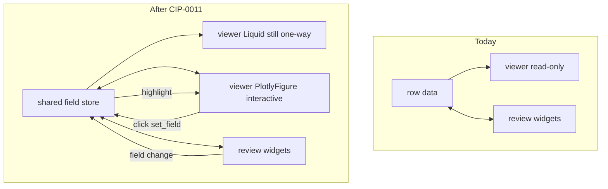

# CIP-0011: Interactive viewer components with shared-field bindings to review

> **Note**: CIPs describe HOW to achieve requirements (WHAT).  
> Use `related_requirements` to link to the requirements this CIP implements.

## Status

- [x] Proposed - Initial idea documented
- [ ] Accepted - Approved, ready to start work
- [ ] In Progress - Actively being implemented
- [ ] Implemented - Work complete, awaiting verification
- [ ] Closed - Verified and complete
- [ ] Rejected - Will not be implemented
- [ ] Deferred - Postponed

## Summary

Change the **viewer contract** from universally read-only display to a typed surface where some entries are interactive and participate in the **same field store** as `review:`. Interactive entries (v1: `PlotlyFigure`, `StaticImage`) declare `on:` / `highlight:` bindings so figure events write context fields (refreshing review widgets) and review edits restyle the figure.

This implements [REQ-000F](../requirements/req000F_interactive-viewer-components.md). It does **not** introduce a top-level `visualiser:` slot or new `display.layout` names; existing `side_by_side` remains the composition for look-at + assess.

## Motivation

Document and thesis workflows already use `viewer:` for subject text and `review:` for judgment. Soft-geometry workflows (mixture of PPCA topic exploration, as in multilogue / pub-dialogue CIP-0017) need the same composition, but with **interaction on the look-at surface** and **propagation into assessment state**. Today that interaction only exists in notebooks (e.g. multilogue `uq_click_readout_panel`); referia’s viewer cannot write fields.

Inventing a third layout region would duplicate the viewer column for the common case. The real gap is the viewer contract, not composition.

## Detailed Description

### What changes



| Surface | Today | After |
|---------|--------|--------|
| Liquid / Markdown viewer | Display only | Unchanged (one-way) |
| Interactive viewer entry | Does not exist | Events write fields; can restyle from fields |
| Review | Reads/writes fields | Same API; refreshes when viewer writes fields |
| Propagation viewer → review | None | Via shared fields + widget refresh |

### Viewer vs review (anagrams, different jobs)

Which YAML block owns the **component** is decided by the job of the interaction, not by whether it writes a field.

| | **Viewer** | **Review** |
|---|------------|------------|
| Job | Perceive / explore the **subject** | Record **judgment** |
| Writes allowed | Selection / context / navigation | Assessment product |
| Anti-pattern | Plot-only scoring with no review widget | Only copy of subject/geometry buried under `review:` |

**Intent tests:**

1. If the human stopped assessing, would this control still make sense for exploring the subject? → viewer.
2. Is the write the judgment itself, or only the pointer used while judging? Pointer → viewer may write it; judgment → `review:` owns the widget.
3. Would we export this field as the assessment’s meaning? Core scores/notes → review-authored; last-clicked point is context scaffolding.

**Shared fields are fine.** `selected_topic` may be set by plot click and by a Dropdown. Ownership of the Dropdown stays in `review:`; ownership of the figure stays in `viewer:`.

### Field roles (authoring concepts, not new dtypes)

| Role | Meaning | Typical writers |
|------|---------|-----------------|
| judgment | Assessment product | `review:` widgets |
| context | Selection / pointer | Viewer `on:` and/or review dropdowns |
| explore | View-only geometry knobs | Viewer chrome; persist only if replay needs it |
| derived | Compute outputs (figure JSON, soft \(R\)) | `compute:` / multilogue |

**v1 declaration:** implicit by placement + binding use. No required `role:` annotation. Document the convention here (explicit–implicit separation). Optional later: `fields:` metadata for export/multiverse.

**Explore parameters** may live on viewer components when they only change how you look. If the same control is “which topic am I scoring?”, put a review widget on that field and let `highlight` follow it.

**Persist:** Viewer-driven `set_field` uses the same persist path as review edits for that field. No shadow state. Provenance graphs (“set by click”) are out of scope for v1.

### Config sketch

```yaml
display:
  layout: side_by_side

viewer:
  - liquid: |
      ## Topic geometry
  - type: PlotlyFigure
    field: topic_scatter_spec
    on:
      click_point:
        - set_field: selected_phrase
          from: customdata.phrase
        - set_field: selected_topic
          from: customdata.topic
        - set_field: topic_mass
          from: customdata.responsibilities
    highlight:
      from_field: selected_topic
      mode: responsibility_ink

review:
  - field: selected_topic
    type: Dropdown
  - field: selected_phrase
    type: Text
  - field: topic_mass
    type: Text
  - field: notes
    type: Textarea
```

Exact key names may be refined at implementation; the contract is typed viewer entries + bidirectional bindings through the shared store.

Liquid/Markdown remains the default when `type:` is omitted. Interactivity requires explicit `type:` and (for writeback) `on:`.

### MPPCA exemplar

Shared soft state (responsibilities \(R\), topic means) is owned by data/compute (multilogue `mppca` / pub-dialogue CIP-0017), not duplicated in the plot.

| Direction | Behaviour |
|-----------|-----------|
| Figure → review | Click phrase → `selected_phrase`, `selected_topic`, soft mass fields |
| Figure → review | Select topic / points → exemplars and diagnostics in review widgets |
| Review → figure | Topic dropdown → rehighlight / reproject (ink ∝ \(r_{ik}\)) |
| Shared refresh | Index change refreshes viewer components and review from the same row |

Same idea as multilogue `uq_click_readout_panel`, with `review:` as the readout instead of a one-off HTML box.

Figure payloads (Plotly JSON + `customdata`) are produced by domain libraries (e.g. `multilogue.viz`). Referia hosts chrome and field sync; it does not reimplement MPPCA.

### Rendering (HOW outline)

- Extend `_create_viewer` / `WebReviewer.render_viewer_html` / Jupyter viewer path to handle non-Markdown entries.
- **PlotlyFigure:** structured figure JSON from a field; web loads Plotly.js when needed; Jupyter uses FigureWidget where available.
- **StaticImage:** path/URL fallback (non-interactive).
- Prefer structured specs over opaque HTML so bindings are reliable; raw HTML escape hatch only if needed later.
- Outbound: `plotly_click` (web) / `on_click` (Jupyter) → same `set_value` / `/field/{col}` paths review already uses → review partial refresh.
- Inbound: watch `highlight.from_field` → restyle traces.
- Security: figure specs and customdata are author/compute-controlled (same trust as Liquid viewer).

### Layout (explicit non-goal for v1)

[REQ-000E](../requirements/req000E_named-layout-compositions.md) / [CIP-0010](./cip0010.md) named compositions stay as they are. Interactive figures stack under `viewer:` beside `review:` under `side_by_side`. Promote a dedicated third region only if a real workflow needs prose | plot | form as independent columns.

### Sequencing with other work

| Track | Relation |
|-------|----------|
| pub-dialogue CIP-0017 soft MPPCA **data** path | Parallel; does not need this UI |
| Interactive topic/lens plots in referia | After this CIP Accepted + binding v1 |
| Interim | Notebooks + `multilogue.viz` |
| vongole (lynguine CIP-0007) | **Deferred** — generic plot helpers may move later; UI chrome stays referia |

### Tenet trade-off

Convenience (implicit roles) vs strict audit typing: **v1 prefers convenience**; optional `fields.role` when export/multiverse need them.

## Implementation Plan

1. **Accept this CIP** after design review (natural pause while Proposed).
2. **Dialect / Interface:** recognise typed viewer entries; keep omitted-type Liquid/Markdown behaviour.
3. **Jupyter Reviewer:** render PlotlyFigure / StaticImage in the viewer cluster; wire FigureWidget clicks to `set_value` and highlight observers.
4. **Web (CIP-000B path):** render figure container; Plotly.js events → field routes; HTMX/partial refresh of review widgets; restyle on field change.
5. **Tests:** Liquid-only unchanged; click sets field and review reflects it; field change updates highlight; missing bindings degrade without crash.
6. **Docs:** config examples; viewer vs review intent tests; optional later field-role metadata note.
7. **Consumer follow-on (separate PRs):** multilogue/pub-dialogue emit figure JSON + customdata aligned with binding keys.

## Backward Compatibility

- Configs without typed interactive viewer entries: unchanged.
- New keys (`type`, `on`, `highlight`) only on opt-in entries.
- No rename of `viewer:` / `review:`; no required layout migration.

## Testing Strategy

- Unit: parse typed viewer entries; binding resolution; Liquid-only regression.
- Integration (Jupyter): FigureWidget click → field → review widget value.
- Integration (web): plotly_click → field route → review fragment contains new value; review POST → figure highlight attribute/class update.
- Fixture: synthetic figure JSON with customdata; no live LLM required.

## Related Requirements

- [REQ-000F](../requirements/req000F_interactive-viewer-components.md) — interactive viewer + shared-field propagation (this CIP)
- [REQ-000E](../requirements/req000E_named-layout-compositions.md) — layout composition unchanged for v1
- CIP-000B — web render target
- CIP-0010 — `side_by_side` / `inline_list` compositions

## Implementation Status

- [x] Design documented (Proposed)
- [ ] Accepted
- [ ] Dialect + typed viewer entries
- [ ] Jupyter interactive viewer + bindings
- [ ] Web interactive viewer + bindings
- [ ] Tests green
- [ ] Docs / examples
- [ ] Closed

## References

- Design discussion (2026-10-19): interactive viewer as component type; viewer→review propagation; roles implicit
- multilogue `viz.uq_click_readout_panel` / topic soft geometry (motivating exemplar)
- pub-dialogue CIP-0017 (soft-throughout MPPCA data; UI after this CIP)
- lynguine CIP-0007 (vongole) — deferred for this work
